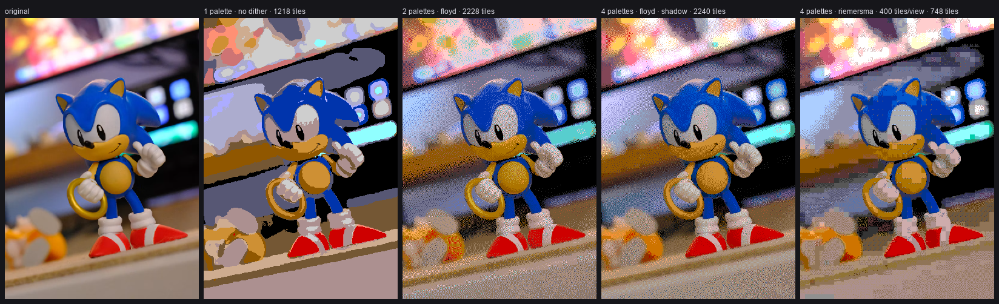

# RenRetroDev

Tools for Sega Mega Drive / Genesis homebrew development.

| Tool | What it does | Download |
|---|---|---|
| [MD Background Tools](md-background-tools/) | Convert any picture into a Mega Drive background: palettes on the 512-colour grid, 8×8 tiles with a per-screen budget, dithering, VDP shadow, and files ready for SGDK. | [v1.0 for Windows](https://github.com/ultraover/RenRetroDev/releases/tag/md-background-tools-v1.0) |

All tools are MIT-licensed (see [LICENSE](LICENSE)). © 2026 RenRetroDev.
