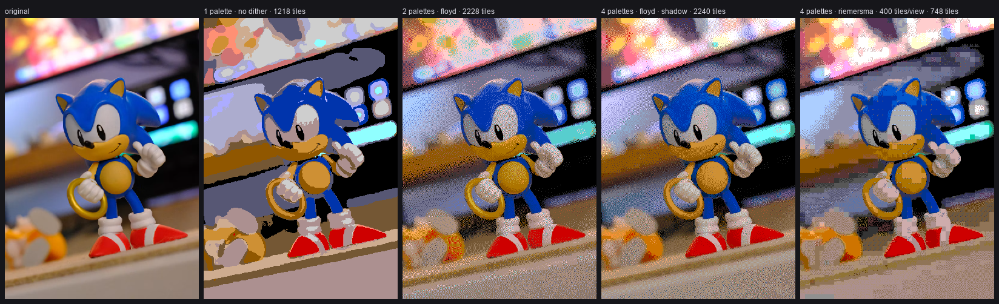
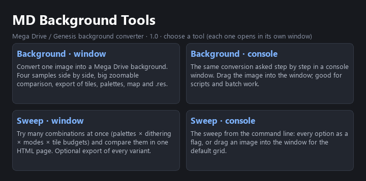
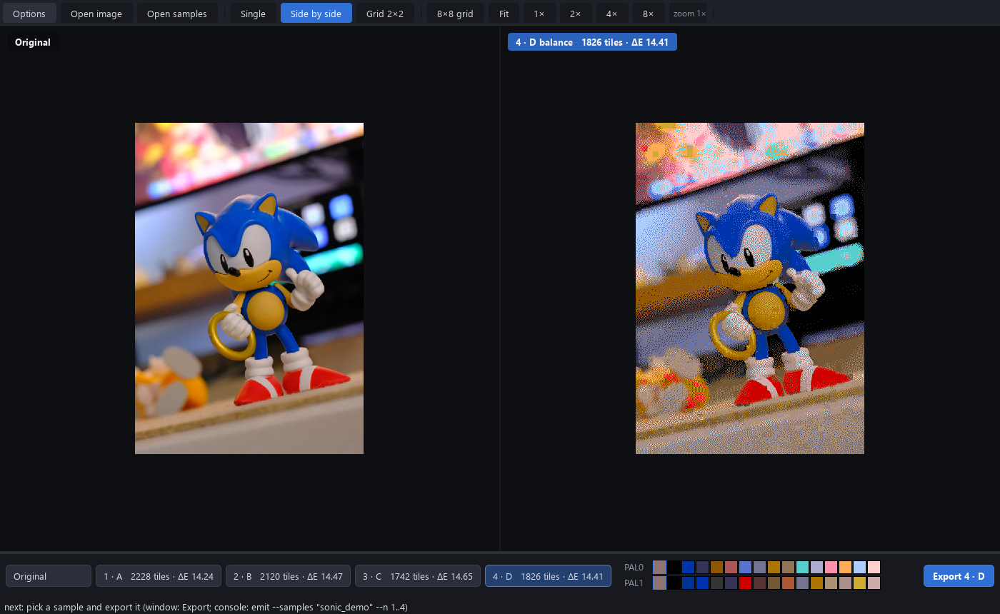
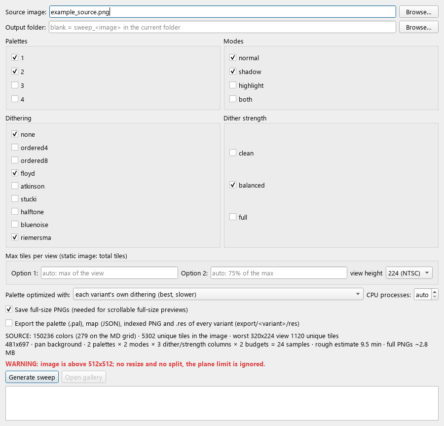

# MD Background Tools

Convert any picture into a **Sega Mega Drive / Genesis background**: palettes on the
real 512-colour grid, 8×8 tiles with mirror deduplication, a tile budget per
screen, dithering, VDP shadow, and ready-to-use files for
[SGDK](https://github.com/Stephane-D/SGDK) (`.res`, `.pal`, indexed PNG, map JSON
and sample C code).



*Original photo, then: 1 palette without dithering · 2 palettes with Floyd-Steinberg ·
4 palettes with Floyd-Steinberg and VDP shadow · 4 palettes with Riemersma and a
budget of 400 unique tiles per screen.*

One program, four tools, picked from a start screen:



| Tool | What it is for |
|---|---|
| **Background · window** | Convert one image. Four samples side by side in a big, zoomable, pixel-exact comparison; export the one you like. |
| **Background · console** | The same conversion, asked step by step in a console. Drag the image into the window. Every question is also a command-line flag. |
| **Sweep · window** | Try many combinations at once (palettes × dithering × modes × tile budgets) and compare them all in one HTML page. |
| **Sweep · console** | The sweep from the command line, for scripts and batch work. |

## Quick start (Windows)

1. Download `MD_Background_Tools.exe` from the [release page](https://github.com/ultraover/RenRetroDev/releases/tag/md-background-tools-v1.2).
2. Double-click it and pick a tool.
3. In **Background · window**, drop an image, choose the options and press
   **Generate samples**. Compare the four samples, pick one, press **Export**.

No installation is needed. The program keeps its settings (`profile.json`), the
default `res/` export folder and any error log in
`Documents\MD Background Tools`.

> **Antivirus warning.** Single-file Python programs are sometimes flagged by
> mistake. The full source is in `src/`, and `SHA256SUMS.txt` lists the hash of
> the released `.exe` so you can check that your download is the published one.



## What it does

- **Palettes:** 1 to 4 palettes of 15 colours plus a shared backdrop (index 0),
  chosen by k-means in Lab on the MD 8-level grid. Every 8×8 tile picks the
  palette that draws it best. You can also start from your own palette file.
- **Tiles:** identical and mirrored (H, V, HV) tiles count once. The tile budget
  applies to the **whole image** or to **every 320×224 (NTSC) / 320×240 (PAL)
  view** of a scrolling background. The per-view check slides one tile at a
  time, so every camera position fits. Over-budget tiles are merged into the
  closest real tile, judged in the palette of the position that changes.
- **Dithering:** `none`, `ordered4`, `ordered8`, `floyd`, `atkinson`, `stucki`,
  `halftone`, `bluenoise`, `riemersma`, each with `clean` / `balanced` / `full`
  strength. The palette is optimized with the dithering it will be shown with.
- **Shadow (VDP shadow/highlight mode):** a low-priority tile is shown at half
  brightness, which costs no colours. In `shadow` mode the tool plans the
  shadow together with the palettes, so the 15 colours can leave the darks to
  the shadow. It avoids an 8×8 mosaic on smooth areas and counts the darkened
  backdrop. The shadow is written into the map (the tile priority bit).
  In your game, that priority bit also decides what is drawn in front: the
  normal tiles are high priority, so give your sprites high priority too; the
  shadow only shows where both planes are low priority; and on sprites, PAL3
  colours 14 and 15 become highlight and shadow operators instead of colours.
  `report.md` explains it next to the export.
  A flat dark area ringed by bright detail (a pit next to rock) goes normal
  on one solid colour, so its border shows no dotted halo. Both windows have a
  checkbox for it; on the command line, `--shadow-edges dotted` (Background)
  or `--shadow-dotted-edges` (Sweep) keeps the old way.
  A flat shape with a sharp outline (a door in a dark wall) is never split
  between normal and shadow tiles, so its outline stays; dark shapes go
  shadow even when the colour is a little less exact (contour before colour).
  Both windows have a "keep contours" checkbox; on the command line,
  `--shadow-contours off` (Background) or `--shadow-free-contours` (Sweep)
  lets each tile pick on its own again.
- **Highlight:** on a plane, highlight needs sprites (PAL3 colour 14), so the tool
  only **measures** it. It reports how much it would help and how many sprites
  it would take against the VDP limits (80 per screen, 20 and 320 px per line),
  and shows a preview.
- **Backdrop:** the border colour becomes the transparent backdrop only when the
  file has transparency, or when almost all of the border is that colour. A sky
  or a gradient at the edge stays part of the art.
- **Metrics:** mean and 95th-percentile ΔE (Lab), plus a *perceived* ΔE on a
  blurred copy in linear light, which is closer to what the eye sees with
  dithering. The numbers are a guide: trust your eyes.



## Output files

For the exported sample, or for a sweep variant:

- **Sweep, just the one you like:** each picture in `sweep.html` has its name
  under it (`p1_floyd_balanced_t1150_shadow`). In the Sweep window, the box
  **Export one sample** lists the variants of the last sweep (or of an older
  sweep folder you browse to); pick one and press **Export this one**. The
  variant is computed again from the options saved in `sweep.json`, checked
  pixel by pixel against the gallery, and written to `export/<name>/res/`.
  In the console, drag a sweep folder into the window and type its number.
- **Every variant at once:** the checkbox "Export ... of EVERY variant" (or
  `--export`) before the sweep.

| File | Content |
|---|---|
| `name16.png` | Indexed PNG: bits 0-3 colour, 4-5 palette, 7 priority (0 = shadowed tile). Ready for `rescomp`. |
| `name_pal0..3.pal` | The palettes (JASC-PAL). Index 0 is the shared backdrop. |
| `name.res` | SGDK resource file. |
| `name_map.json` | Palette and normal/shadow for every tile position. |
| `name_preview.png` | RGB preview of what the Mega Drive shows. |
| `report.md` | Tile measurement, palettes and sample C code (plane A, free scroll on the pad). |

## Command line

```
MD_Background_Tools.exe --run background-console sample --source pic.png --palettes 2 --dithering floyd --mode shadow --max-tiles 900 --cap-scope view --no-ask
MD_Background_Tools.exe --run background-console emit --samples pic/samples.json --n 1 --name wall --res res/wall.res
MD_Background_Tools.exe --run sweep-console sweep --source pic.png --palettes 1,2 --dithering none,floyd,riemersma --modes normal,shadow --max-tiles 900,700 --export
MD_Background_Tools.exe --run sweep-console export --sweep sweep_pic --variant p1_floyd_balanced_t900_shadow
```

`export --sweep <folder>` without `--variant` lists the variants with their
numbers; `--variant` takes a name, a number or a comma list.

Add `--help` after `sample` or `sweep` for every option. The sweep runs several
variants at once on several CPU cores (`--workers N`; default: cores − 1, limited
by free memory). Useful sweep flags:
`--palette-dither none` (one shared palette, faster), `--shadow-late` (old shadow,
decided at the end), `--full` (full-size previews), `--view-height 240` (PAL).

## Known limitations

- **Tile reduction is slow on big images.** A wide scrolling background with a
  tight per-view budget can take several minutes per variant. The sweep runs
  variants in parallel on several cores, but each variant still uses one.
- **Highlight is measured, not exported.** On hardware it needs sprites over the
  area; the tool tells you how many and whether they fit.
- **Shadow works per 8×8 tile.** The tool softens the border of shadow regions on
  smooth areas, but a faint tile staircase can remain on a gradient.
- **The numbers are a guide, not a judge.** ΔE measures how far each pixel is
  from the original; it does not see whether a gradient became a step or a
  flat area got noisy. When the numbers and your eyes disagree, trust your eyes.
- **Images up to 512×512 px fit one VDP plane.** Bigger images are converted,
  but scrolling or splitting them is up to your ROM code.
- **Windows build only.** The source also runs on macOS and Linux, but only the
  Windows `.exe` is tested and released.

## Running from source

Python 3.10+ on Windows, macOS or Linux:

```
cd md-background-tools
pip install -r requirements.txt
python src/md_tools.py
```

`numba` is optional (it makes the dithering about 50× faster). To build the
single-file `.exe`: `pip install pyinstaller` and `python build.py`.

## License and credits

MIT, see [LICENSE](LICENSE). © 2026 RenRetroDev.

The release bundles third-party libraries (Python, Qt/PySide6, NumPy, SciPy,
Pillow, Numba); see [THIRD_PARTY_NOTICES.md](THIRD_PARTY_NOTICES.md).

The example photo comes from Unsplash (Unsplash License). Sonic the Hedgehog is a
trademark of SEGA. This project is not affiliated with or endorsed by SEGA.
