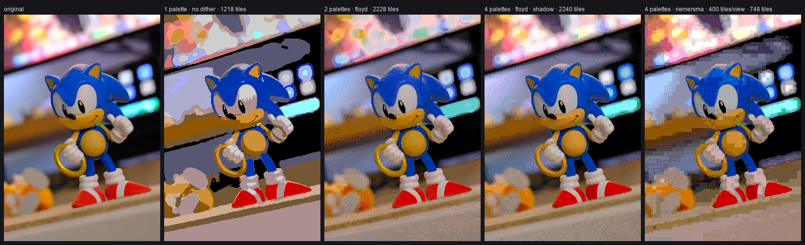
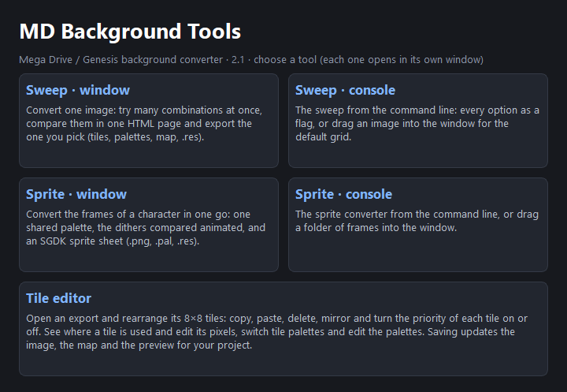
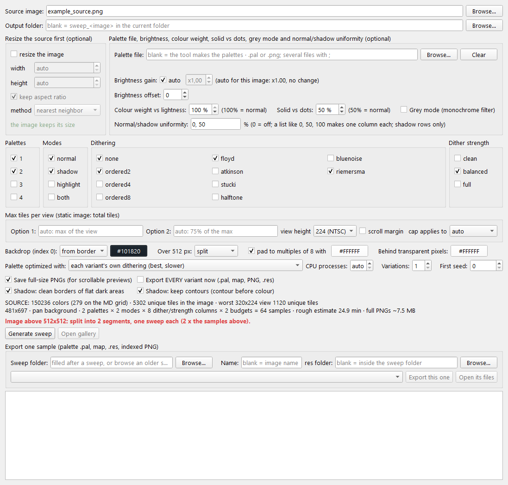

# MD Background Tools

Convert any picture into a **Sega Mega Drive / Genesis background**: palettes on the
real 512-colour grid, 8×8 tiles with mirror deduplication, a tile budget per
screen, dithering, VDP shadow, and ready-to-use files for
[SGDK](https://github.com/Stephane-D/SGDK) (`.res`, `.pal`, indexed PNG, map JSON
and sample C code).



*Original photo, then: 1 palette without dithering · 2 palettes with Floyd-Steinberg ·
4 palettes with Floyd-Steinberg and VDP shadow · 4 palettes with Riemersma and a
budget of 400 unique tiles per screen.*

One program, three tools, picked from a start screen:



| Tool | What it is for |
|---|---|
| **Sweep · window** | Convert one image: try many combinations at once (palettes × dithering × modes × tile budgets), compare them all in one HTML page and export the one you like. |
| **Sweep · console** | The sweep from the command line, for scripts and batch work. |
| **Tile editor** | Open an export and rearrange its 8×8 tiles: copy, paste, delete, mirror, and turn each tile's priority on or off. Select a tile to see how many times it is used and where; edit its pixels, switch its palette, and see and replace the colours of the palettes, each in a window of its own. Saving updates the image, the map and the preview. |

## Quick start (Windows)

1. Download `MD_Background_Tools.exe` from the [release page](https://github.com/ultraover/RenRetroDev/releases/tag/md-background-tools-v2.0).
2. Double-click it and pick a tool.
3. In **Sweep · window**, drop an image, tick the combinations to try and
   press the run button. Compare them in the gallery, pick one in **Export one
   sample**, give it a name and your project's `res` folder, and press
   **Export this one**.

The Background tool of v1.2 (four samples side by side) is no longer on the
start screen: the Sweep does everything it did. It still runs with
`--run background-gui` or `--run background-console`.

No installation is needed. The program keeps its settings (`profile.json`), the
default `res/` export folder and any error log in
`Documents\MD Background Tools`.

> **Antivirus warning.** Single-file Python programs are sometimes flagged by
> mistake. The full source is in `src/`, and `SHA256SUMS.txt` lists the hash of
> the released `.exe` so you can check that your download is the published one.

## What it does

- **Palettes:** 1 to 4 palettes of 15 colours plus a shared backdrop (index 0),
  chosen by k-means in Lab on the MD 8-level grid. Every 8×8 tile picks the
  palette that draws it best. You can also start from your own palette file.
- **Tiles:** identical and mirrored (H, V, HV) tiles count once. The tile budget
  applies to the **whole image** or to **every 320×224 (NTSC) / 320×240 (PAL)
  view** of a scrolling background. The per-view check slides one tile at a
  time, so every camera position fits. Over-budget tiles are merged into the
  closest real tile, judged in the palette of the position that changes.
  **Scroll margin** (Sweep and Tile editor): a game that scrolls
  pixel by pixel shows, between two tile steps, part of one more tile column
  and row (41 × 29 tiles in NTSC, 41 × 31 in PAL), and all of them must be in
  VRAM at once. With the margin on, the per-view cap counts those windows (on
  an axis no longer than the view, nothing changes: a 320 px wide image gets
  only the extra row). Command line: `--scroll-margin`.
- **Dithering:** `none`, `ordered2`, `ordered4`, `ordered8`, `floyd`,
  `atkinson`, `stucki`, `halftone`, `bluenoise`, `riemersma`, each with
  `clean` / `balanced` / `full` strength. The palette is optimized with the
  dithering it will be shown with.
- **`ordered2` (Bayer 2×2, 2N−1 tones):** the colours of the palette are put
  in order of lightness and each one mixes only with its neighbour, always
  half and half, as a fine checkerboard. So N colours give 2N−1 tones: the N
  colours plus one in-between tone for each pair of neighbours, with no 25% or
  75% mixes and no far colours mixed. It is made for palettes that climb in
  lightness (a ladder palette, grey mode). The strength sets how much closer
  the checker must come than the solid colour (`full` uses it whenever it is
  closer, `clean` asks for 2 ΔE). In the Sweep it starts unticked.
- **Shadow (VDP shadow/highlight mode):** a low-priority tile is shown at half
  brightness, which costs no colours. In `shadow` mode the tool plans the
  shadow together with the palettes, so the 15 colours can leave the darks to
  the shadow. It avoids an 8×8 mosaic on smooth areas and counts the darkened
  backdrop. The shadow is written into the map (the tile priority bit).
  In your game, that priority bit also decides what is drawn in front: the
  normal tiles are high priority, so give your sprites high priority too; the
  shadow only shows where both planes are low priority; and on sprites, PAL3
  colours 14 and 15 become highlight and shadow operators instead of colours.
  `report.md` explains it next to the export.
  A flat dark area ringed by bright detail (a pit next to rock) goes normal
  on one solid colour, so its border shows no dotted halo. The Sweep window has a
  checkbox for it; on the command line, `--shadow-dotted-edges` keeps the old
  way.
  A flat shape with a sharp outline (a door in a dark wall) is never split
  between normal and shadow tiles, so its outline stays; dark shapes go
  shadow even when the colour is a little less exact (contour before colour).
  The Sweep window has a "keep contours" checkbox; on the command line,
  `--shadow-free-contours` lets each tile pick on its own again.
- **Highlight:** on a plane, highlight needs sprites (PAL3 colour 14), so the tool
  only **measures** it. It reports how much it would help and how many sprites
  it would take against the VDP limits (80 per screen, 20 and 320 px per line),
  and shows a preview.
- **Resize:** the Sweep can resize the picture before the conversion. Type
  only the width or only the height and keep the aspect ratio, or untick it
  and give both sides. Pick the method: `nearest` (the default, sharp, adds no
  colour, right for pixel art), `bilinear`, `bicubic`, `lanczos` or `area`
  (smoother, best to shrink a photo or a painting, but they add in-between
  colours the palette has to absorb). On the command line: `--resize 400x`
  (width 400), `--resize x300` (height 300), `--resize 400x300` (both) and
  `--resize-method lanczos`.
- **Palette file in the Sweep:** give a `.pal` (JASC-PAL or plain `R G B`
  lines) or a `.png` (indexed, or a strip of colours) and the Sweep uses those
  colours instead of making its own palettes. Every 16 colours make one
  palette, up to 4 (64 colours); in a block of 16, colour 0 is the backdrop
  slot and the Sweep's backdrop goes there. A file with 15 colours or fewer has
  only colours. Several files, one palette each: separate them with `;`. The
  palette count then comes from the file. Command line: `--palette-file`.
- **Brightness gain in the Sweep:** "auto" (the default) brightens the picture
  until its brightest pixels reach about 230, and never darkens it; the window
  shows what auto would use for the loaded image. Untick it to type the gain
  (1.00 = no change), and add a brightness offset if needed. Command line:
  `--gain none`, `--gain 1.2`, `--brightness -10`.
- **Colour weight:** how much a difference of colour
  counts against a difference of lightness, in every colour comparison of the
  conversion (the colour of each pixel, the palette of each tile, the palettes
  made). 100% is normal; 0% counts only the lightness. Lower, a slightly
  tinted colour of the right lightness can win over a grey of the wrong one;
  the colour error left over still goes to the neighbours, so they lean to
  the opposite tint and the mix stays neutral. The result: smoother tones and
  fewer dots, with a little tint. On a grey picture it needs a palette with
  near-greys (a palette file; pairs of opposite tints work best). 40% is a
  good start. Command line: `--color-weight 0.4`.
- **Grey mode:** for a game seen through a monochrome
  filter. Every colour counts only as the grey the filter shows: the MD levels
  as BlastEm outputs them (0, 49, 87, 119, 146, 174, 206, 255, and its shadow
  and highlight steps), weighted by Rec.601 (0.299 R + 0.587 G + 0.114 B). Any
  colour of the right grey will do, so the picture looks odd in colour and
  right through the filter. The palettes it makes pick, from all 512
  colours, the greys the picture needs: a grey cave went from 4 greys to 39.
  A palette file that climbs in grey (60 colours, one grey each) works too.
  Command line: `--grey`.
- **Solid vs dots (Sweep):** a preference between dots and solid colour for
  every dither, ordered and diffusion. 50% is normal (the strength preset as it
  is). Higher, a dither must win by more before it draws dots and the
  diffusions spread less error: smoother and flatter. Lower, it dithers more
  readily: more tones, more grain. The palette of each tile follows the same
  preference. Command line: `--solid 0.7`.
- **Backdrop:** the border colour becomes the transparent backdrop only when the
  file has transparency, or when almost all of the border is that colour. A sky
  or a gradient at the edge stays part of the art. Or pick a **fixed colour**
  ("Backdrop (index 0)" in the Sweep, `--backdrop color --backdrop-color 000034`):
  its pixels are always holes.
- **Over 512 px (Sweep):** a plane holds at most 512×512 px. **keep** leaves the
  size (the ROM handles it, for a streamed background), **shrink to fit**
  resizes it, **split** cuts it into the fewest pieces that fit, as even as they
  can be, and runs one sweep per piece, each in its own folder; `split.html`
  lists them and `split.json` gives the position of every piece. Gain, backdrop
  and transparency come from the whole image, so the pieces match. Command
  line: `--oversize none|resize|split`.
- **Padding and transparency (Sweep):** sides that are not multiples of 8 are
  padded on the bottom and right border with a colour you pick (untick it to
  require exact sides); an alpha channel is composited on the colour of
  "Behind transparent pixels". Command line: `--no-pad`, `--pad-color`,
  `--bg-color`.
- **Metrics:** mean and 95th-percentile ΔE (Lab), plus a *perceived* ΔE on a
  blurred copy in linear light, which is closer to what the eye sees with
  dithering. The numbers are a guide: trust your eyes.



## Tile editor

Open an export folder (or its `res/` folder, the `.res` or `name16.png`; you can
also drag it onto the window). The image is shown as the Mega Drive shows it, on
the 8×8 grid, with zoom from 1× to 16× (Ctrl + mouse wheel).

- Click a tile to select it; drag or Shift+click for a rectangle.
- **Copy** (Ctrl+C), **Paste** (Ctrl+V, replaces the tiles at the selection; one
  copied tile fills a bigger selection), **Delete** (Del, empty tile in the
  backdrop colour), **Flip H** / **Flip V** (H, V; the Mega Drive mirrors tiles
  for free), **Undo** / **Redo** (Ctrl+Z, Ctrl+Y).
- **Priority** (P) turns the priority of the selected tiles on or off. With
  shadow/highlight (images exported in shadow mode), a low-priority tile is
  shown darkened, as on the console; without it, priority only puts the tile in
  front of or behind low-priority sprites. "show priority" paints the
  low-priority tiles red.
- **Where a tile is used:** select one tile and the bottom line says how many
  times the image uses it; every place is marked on the grid (blue: the same
  drawing, pink: the same drawing mirrored). It is the same tile in VRAM
  whatever palette each place uses. "mark where the selected tile is used"
  turns the marks off.
- **Edit pixels…** (E, or double click a tile) opens a window of its own with
  the 8×8 pixels of the selected tile, big, and the 16 colours of its
  palette: left click or drag paints, right click picks a pixel's colour. The
  change goes to every place that uses the tile (a mirrored place gets the
  pixel mirrored), or, if you choose, only to this place, which then becomes
  a tile of its own. The window follows the tile you select in the editor;
  each stroke is one undo step.
- **Tile palette** (keys 0-3) makes the selected tiles use another of the
  export's palettes. The colour numbers stay, so the tiles take the colours of
  the new palette; tick "keep the look" in the menu and every pixel takes the
  closest colour of the new palette instead (the drawing may change, so the
  tile count can change too).
- **Palettes…** (C) opens a window of its own with the palettes of the export.
  Click a colour to see how many pixels and tile places use it, how many of
  those pixels are on shadow tiles and its rank; the editor dims the rest of
  the image and frames the tiles that use it. The table lists every colour
  (click a column title to sort by the most or least used) and the top line
  names the most used, the least used and the unused ones, free to take
  another colour. Below, the 512 Mega Drive colours (one block per blue level)
  replace the selected colour with a click; "show colours as: shadow" shows
  them as a low-priority tile shows them with shadow/highlight. Colour 0 is
  the backdrop of every palette, so it changes in all of them.
- A copied tile keeps its palette and priority. The bottom line counts the
  unique tiles (mirrors included, as rescomp does) and the worst 320×224 view,
  next to the numbers when the file was opened.
- **Save** (Ctrl+S) rewrites `name16.png` (the first save keeps
  `name16.orig.png`), `name_map.json` (palette, shadow and priority per
  position) and `name_preview.png`. The `name_palN.pal` files are rewritten
  only when a palette colour changed (the first time keeps
  `name_palN.orig.pal`). The `.res` does not change: rebuild the project and
  the map and palettes follow.


## Output files

For the exported sample, or for a sweep variant:

- **Sweep, just the one you like:** each picture in `sweep.html` has its name
  under it (`p1_floyd_balanced_t1150_shadow`). In the Sweep window, the box
  **Export one sample** lists the variants of the last sweep (or of an older
  sweep folder you browse to); pick one and press **Export this one**. The
  variant is computed again from the options saved in `sweep.json`, checked
  pixel by pixel against the gallery, and written to `export/<name>/res/`, or,
  with a **Name** and a **res folder**, straight into your project as
  `<name>.res` and its files (files of the same name there are replaced).
  Command line: `export --name wall --res C:\game\res`.
  In the console, drag a sweep folder into the window and type its number.
- **Every variant at once:** the checkbox "Export ... of EVERY variant" (or
  `--export`) before the sweep.

| File | Content |
|---|---|
| `name16.png` | Indexed PNG: bits 0-3 colour, 4-5 palette, 7 priority (0 = shadowed tile). Ready for `rescomp`. |
| `name_pal0..3.pal` | The palettes (JASC-PAL). Index 0 is the shared backdrop. |
| `name.res` | SGDK resource file. |
| `name_map.json` | Palette and normal/shadow for every tile position. |
| `name_preview.png` | RGB preview of what the Mega Drive shows. |
| `report.md` | Tile measurement, palettes and sample C code (plane A, free scroll on the pad). |

## Command line

```
MD_Background_Tools.exe --run sweep-console sweep --source pic.png --palettes 1,2 --dithering none,floyd,riemersma --modes normal,shadow --max-tiles 900,700 --export
MD_Background_Tools.exe --run sweep-console export --sweep sweep_pic --variant p1_floyd_balanced_t900_shadow --name wall --res res
MD_Background_Tools.exe --run sweep-console sweep --source tall.png --oversize split --palettes 2 --dithering ordered2 --solid 0.6
MD_Background_Tools.exe --run sweep-console sweep --source pic.png --resize x224 --resize-method area --palettes 1 --modes shadow
```

`export --sweep <folder>` without `--variant` lists the variants with their
numbers; `--variant` takes a name, a number or a comma list.

Add `--help` after `sweep` or `export` for every option. The sweep runs several
variants at once on several CPU cores (`--workers N`; default: cores − 1, limited
by free memory). Useful sweep flags:
`--palette-dither none` (one shared palette, faster), `--shadow-late` (old shadow,
decided at the end), `--full` (full-size previews), `--view-height 240` (PAL).

**Variations** ("Variations" in the Sweep window, `--variations N`): every
combination runs N times, with seed 0, 1, 2… (from `--seed`). The seed
changes where the palette search starts and which tiles are merged first, so
each variation is another take on the same task; the gallery shows one row per
seed. The same options and the same seed always give the same picture, on any
number of CPU processes. Variation 0 is the picture a sweep without
variations makes; the others are named `..._s1`, `..._s2` and export like any
variant.

## Known limitations

- **Tile reduction is slow on big images.** A wide scrolling background with a
  tight per-view budget can take several minutes per variant. The sweep runs
  variants in parallel on several cores, but each variant still uses one.
- **Highlight is measured, not exported.** On hardware it needs sprites over the
  area; the tool tells you how many and whether they fit.
- **Shadow works per 8×8 tile.** The tool softens the border of shadow regions on
  smooth areas, but a faint tile staircase can remain on a gradient.
- **The numbers are a guide, not a judge.** ΔE measures how far each pixel is
  from the original; it does not see whether a gradient became a step or a
  flat area got noisy. When the numbers and your eyes disagree, trust your eyes.
- **Images up to 512×512 px fit one VDP plane.** Bigger images are converted
  as they are, shrunk or split into pieces (Sweep, "Over 512 px"), but
  streaming or stitching them on screen is up to your ROM code.
- **Windows build only.** The source also runs on macOS and Linux, but only the
  Windows `.exe` is tested and released.

## Running from source

Python 3.10+ on Windows, macOS or Linux:

```
cd md-background-tools
pip install -r requirements.txt
python src/md_tools.py
```

`numba` is optional (it makes the dithering about 50× faster). To build the
single-file `.exe`: `pip install pyinstaller` and `python build.py`.

## License and credits

MIT, see [LICENSE](LICENSE). © 2026 RenRetroDev.

The release bundles third-party libraries (Python, Qt/PySide6, NumPy, SciPy,
Pillow, Numba); see [THIRD_PARTY_NOTICES.md](THIRD_PARTY_NOTICES.md).

The example photo comes from Unsplash (Unsplash License). Sonic the Hedgehog is a
trademark of SEGA. This project is not affiliated with or endorsed by SEGA.
